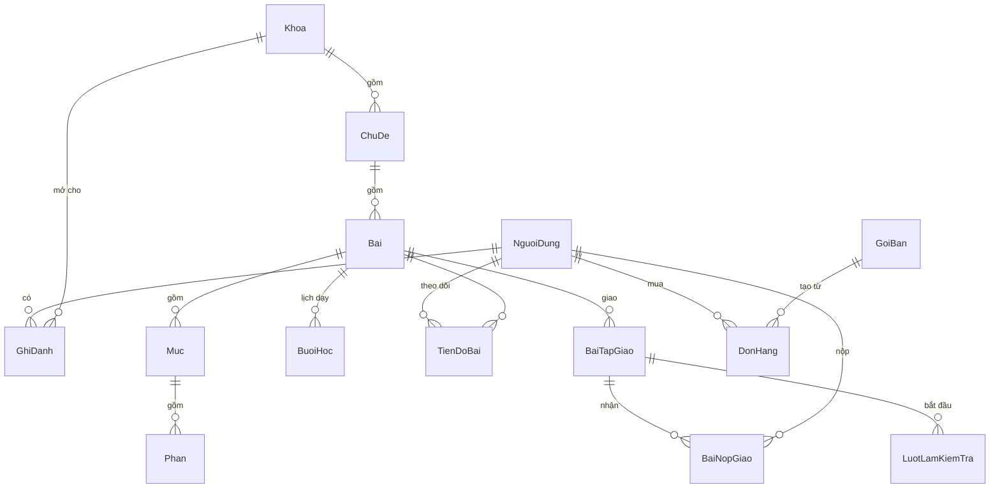

<div align="center">

# 🎓 EduMind-AI — Sử Địa

**Nền tảng học trực tuyến có trợ lý AI cho môn Lịch sử và Địa lí**

Quản lý khoá học · Soạn bài bằng AI · Giao bài & chấm điểm · Hỏi đáp theo tài liệu (RAG)


</div>

---

## Mục lục

1. [Giới thiệu](#1-giới-thiệu)
2. [Tính năng nổi bật](#2-tính-năng-nổi-bật)
3. [Vai trò người dùng](#3-vai-trò-người-dùng)
4. [Kiến trúc hệ thống](#4-kiến-trúc-hệ-thống)
5. [Các luồng hoạt động](#5-các-luồng-hoạt-động)
6. [Công nghệ sử dụng](#6-công-nghệ-sử-dụng)
7. [Mô hình dữ liệu](#7-mô-hình-dữ-liệu)
8. [Cấu trúc thư mục](#8-cấu-trúc-thư-mục)
9. [Bản đồ đường dẫn](#9-bản-đồ-đường-dẫn)
10. [Cài đặt và chạy](#10-cài-đặt-và-chạy)
11. [Cấu hình AI và thanh toán](#11-cấu-hình-ai-và-thanh-toán)
12. [Bảo mật](#12-bảo-mật)
13. [Kiểm thử](#13-kiểm-thử)
14. [Quy trình Git](#14-quy-trình-git)
15. [Hạn chế và hướng phát triển](#15-hạn-chế-và-hướng-phát-triển)

---

## 1. Giới thiệu

**Sử Địa** là ứng dụng web hỗ trợ dạy và học, hiện có nội dung mẫu cho **Lịch sử 12** và **Địa lí 12**. Hệ thống phục vụ trọn vòng đời của một khoá học:

- **Giảng viên** soạn bài (nhập văn bản, Word, PowerPoint; AI hỗ trợ chia mục), giao bài tập, tạo đề kiểm tra có đồng hồ, chấm tự luận và theo dõi tiến độ học viên.
- **Học viên** đọc bài theo mục lục, làm bài tập/kiểm tra, xem điểm, đáp án, lời giải và đặt câu hỏi cho trợ lý AI.
- **Quản trị viên** quản lý người dùng, khoá học, ghi danh, lịch dạy, báo cáo và doanh thu.

Hai chức năng AI hoạt động độc lập:

| Chức năng | Nhà cung cấp | Mục đích |
| --- | --- | --- |
| Soạn bài | Google Gemini | Chia văn bản thành các mục, phần của bài học để giảng viên rà soát |
| Hỏi đáp | Anthropic Claude + RAG | Trả lời câu hỏi của học viên **dựa trên tài liệu khoá**, kèm nguồn |

> Dự án gọi AI qua API, **không** huấn luyện mô hình riêng. Khi chưa có khoá API, trợ lý chạy ở chế độ xem thử.

## 2. Tính năng nổi bật

**Học tập**
- Duyệt khoá → chủ đề → bài; đọc theo mục lục, theo dõi tiến độ.
- Học thử bài đầu; nội dung đầy đủ theo ghi danh còn hạn.
- Ba loại câu hỏi: trắc nghiệm 4 phương án, đúng/sai 4 ý, tự luận.
- Chấm tự động trên máy chủ; đáp án và lời giải chỉ hiện **sau khi nộp**.
- Bắt buộc trả lời đủ câu mới được nộp (đề có đồng hồ vẫn tự nộp khi hết giờ).
- Đề kiểm tra có **đồng hồ do máy chủ giữ**: tải lại trang không đặt lại thời gian.

**Giảng dạy**
- Soạn bài từ văn bản, `.docx`, `.pptx` với bản xem thử để sửa trước khi lưu.
- Hai cách chia mục: **AI (Gemini)** hoặc **theo ký hiệu đề mục** (`#`, `I.`, `1.1.`, `a)`…) hoạt động offline.
- Form giao bài/kiểm tra 3 bước: thông tin chung → soạn câu hỏi → xem lại & xuất bản.
- Chấm tự luận, xem bài nộp, theo dõi điểm từng học viên; lịch dạy kèm link Google Meet.

**Quản trị & kinh doanh**
- Người dùng, vai trò, khoá/mở tài khoản; phân công giảng viên cho khoá.
- Ghi danh có hạn học; gói học và đơn hàng, tích hợp cổng thanh toán PayOS.
- Báo cáo theo ngày/khoá, xuất CSV.

## 3. Vai trò người dùng

| Vai trò | Khu vực | Quyền chính |
| --- | --- | --- |
| Học viên | `/Home`, `/BaiTap` | Học, làm bài, xem điểm, hỏi AI trong phạm vi đã ghi danh |
| Giảng viên | `/GiangVien` | Soạn bài, giao bài, tạo đề, chấm điểm — **chỉ khoá được phân công** |
| Admin | `/Admin` | Toàn bộ khoá học, người dùng, ghi danh, báo cáo, cấu hình trợ lý |

Đăng ký mới luôn tạo tài khoản **học viên** và không tự mở khoá học.

**Module quản trị (`/Admin`):**

| Module | Công việc |
| --- | --- |
| Tổng quan | Chỉ số, hoạt động gần đây, lịch dạy, việc cần xử lý |
| Người dùng · Học viên · Giáo viên | Tạo/sửa tài khoản, vai trò, khoá/mở tài khoản, hồ sơ học tập |
| Khoá học | Tạo/sửa khoá, phân công giảng viên |
| Gói học | Gói bán, giá, số tháng, các khoá đi kèm |
| Ghi danh | Mở quyền học, đặt hạn, lọc còn hạn / hết hạn |
| Bài tập | Theo dõi bài giao, nháp, bài chờ chấm |
| Lịch dạy | Buổi học toàn hệ thống kèm link Meet |
| Doanh thu | Đơn hàng và doanh thu theo thời gian |
| Báo cáo | Lọc theo ngày/khoá, xuất CSV |
| Trợ lý AI | Trạng thái cấu hình, tài liệu nguồn, chạy bộ kiểm thử |

**Tài khoản:** đăng ký, đăng nhập, đăng xuất, hồ sơ cá nhân, đổi mật khẩu, trang quên mật khẩu; truy cập sai vai trò chuyển về trang *Không có quyền*.

## 4. Kiến trúc hệ thống

> Các sơ đồ luồng bên dưới là ảnh SVG động: chấm sáng chạy dọc mũi tên theo từng bước, node được tô sáng khi dữ liệu tới. Mã nguồn sơ đồ nằm ở [docs/images/](docs/images/).

Mô hình **ASP.NET Core MVC** một máy chủ ứng dụng, dữ liệu trong PostgreSQL, AI gọi qua HTTP.

<p align="center"></p>

Luồng trang web thông thường: **Trình duyệt → Controller → Service/DbContext → ViewModel → Razor HTML**. Các API tương tác (trợ lý, bắt đầu làm bài, xem thử) trả JSON cho JavaScript.

## 5. Các luồng hoạt động

### 5.1. Học viên: từ đăng ký đến làm bài

<p align="center"></p>

### 5.2. Làm bài kiểm tra có đồng hồ

<p align="center"></p>

Mỗi học viên chỉ có **một bài nộp** cho mỗi bài tập (ràng buộc duy nhất `bài tập – học viên`).

### 5.3. Giảng viên: soạn bài từ tài liệu

<p align="center"></p>

Việc đọc Word/PowerPoint **không gọi AI**; văn bản chỉ được gửi sang Gemini khi giảng viên chủ động chọn nút AI. Không chạy macro, không cần cài Office.

### 5.4. Giao bài và chấm điểm

<p align="center"></p>

Bài tập đã có bài nộp, hoặc đề đã có lượt làm, sẽ **bị khoá sửa/xoá** để bảo toàn kết quả.

### 5.5. Trợ lý hỏi đáp (RAG)

<p align="center"></p>

- API `POST /api/tro-ly/hoi` có chống CSRF và giới hạn **10 câu/phút**.
- Nguồn hiện là file Markdown trong `TaiLieu/`; nội dung bài soạn trong database **chưa tự đồng bộ** thành nguồn cho trợ lý.
- Lịch sử chat chưa lưu bền, chỉ gửi kèm ngữ cảnh gần nhất từ trình duyệt.

### 5.6. Mua gói học và thanh toán

<p align="center"></p>

- Chỉ tài khoản **học viên** mua được; gói phải đang bán, có giá và gắn ít nhất một khoá.
- Link thanh toán PayOS hết hạn sau **15 phút** (`PayOS:PhutHetHanLink`).
- Hệ thống **không tin tham số trên URL**: trang kết quả hỏi lại PayOS, còn webhook được xác minh bằng chữ ký và kiểm tra số tiền không nhỏ hơn giá gói.
- Xác nhận đơn dùng `UPDATE` có điều kiện trong giao dịch, nên webhook và trang kết quả đến cùng lúc cũng **không cộng hạn học hai lần**.
- Ghi danh còn hạn thì cộng nối tiếp `SoThang` tháng; hết hạn thì tính từ hôm nay; ghi danh không giới hạn được giữ nguyên.
- Ở Development, nếu chưa có khoá PayOS, hệ thống **giả lập thanh toán** để thử trọn luồng. Môi trường thật không có chế độ này.

## 6. Công nghệ sử dụng

| Lớp | Công nghệ |
| --- | --- |
| Ngôn ngữ / nền tảng | C#, .NET 8 |
| Web | ASP.NET Core MVC, Areas, Razor Views |
| Giao diện | HTML, CSS thuần theo từng trang, JavaScript thuần (không framework) |
| Xác thực & phân quyền | ASP.NET Core Identity, cookie, phân quyền theo vai trò, khoá tài khoản sau 5 lần sai |
| Cơ sở dữ liệu | PostgreSQL 14+, Entity Framework Core 8, Npgsql, migrations |
| AI soạn bài | Google Gemini API (`HttpClient`) |
| AI hỏi đáp | Anthropic SDK (Claude) + BM25 tự cài đặt |
| Nhập tài liệu | `ZipArchive` + XML parser (`.docx`, `.pptx`) |
| Thanh toán | PayOS (tạo đơn, webhook) |
| Bộ nhớ đệm | `IMemoryCache` cho bản xem thử theo tài khoản |
| Kiểm thử | Script Python (HTTP + `psql`), Node.js kiểm tra cú pháp JS |

## 7. Mô hình dữ liệu



| Nhóm | Bảng |
| --- | --- |
| Tài khoản | `NguoiDung` + các bảng Identity |
| Nội dung | `Khoa → ChuDe → Bai → Muc → Phan → MocThoiGian` |
| Quyền học | `GhiDanh` (có hạn hoặc không giới hạn) |
| Tiến độ | `TienDoBai` |
| Bài tập & đề mới | `BaiTapGiao` (câu hỏi lưu dạng JSON), `BaiNopGiao`, `LuotLamKiemTra` |
| Luyện tập cũ | `CauHoi`, `DeThiCau`, `BaiLam`, `CauTraLoi` |
| Lịch & bán hàng | `BuoiHoc`, `GoiBan`, `DonHang` |

## 8. Cấu trúc thư mục

```text
SuDia.Web/
├── Program.cs                 # DI, Identity, DB, routing, rate limit, nạp dữ liệu đầu
├── Controllers/               # Trang học viên, tài khoản, làm bài, thanh toán, API trợ lý
├── Areas/
│   ├── GiangVien/             # Soạn nội dung, giao bài, đề thi, chấm điểm, lịch dạy
│   └── Admin/                 # Người dùng, khoá, ghi danh, báo cáo, doanh thu
├── Data/                      # Thực thể, AppDbContext, khởi tạo, dữ liệu mẫu, Migrations/
├── Models/                    # ViewModel, biểu mẫu, mô hình câu hỏi
├── Services/
│   ├── TroLy/                 # Kho tài liệu (BM25), prompt, kiểm tra câu trả lời
│   ├── RagAiService.cs        # Trợ lý Claude
│   ├── GeminiSoanNoiDungAiService.cs
│   ├── DocTaiLieuOffice.cs    # Đọc .docx/.pptx
│   ├── ChiaDeMucVanBan.cs     # Chia mục ngoại tuyến
│   └── PayOSService.cs, DonHangService.cs
├── Views/  wwwroot/           # Razor, CSS, JS, ảnh
├── TaiLieu/                   # Nguồn tri thức cho trợ lý (Markdown)
├── Prompts/                   # Prompt hệ thống
├── KiemThu/                   # Script kiểm thử + bộ câu hỏi AI
├── scripts/                   # Cấu hình khoá AI/PayOS (zsh)
└── docs/                      # Tài liệu chi tiết dự án
```

## 9. Bản đồ đường dẫn

Định tuyến mặc định `{controller=Home}/{action=Index}/{id?}` và `{area}/{controller=TongQuan}/{action=Index}/{id?}`.

| Khu vực | Đường dẫn | Chức năng |
| --- | --- | --- |
| Công khai | `/` | Trang chủ |
| | `/TaiKhoan/DangNhap` · `DangKy` · `QuenMatKhau` | Xác thực |
| Học viên | `/Home/TongQuan` | Tổng quan việc cần làm, lớp sắp tới |
| | `/Home/KhoaHoc/{mã khoá}` | Chi tiết khoá, bài theo chủ đề |
| | `/Home/BaiHoc/{id}` | Đọc bài theo mục lục |
| | `/Home/LuyenDe/{mã khoá}` · `/Home/OnTap` · `/Home/ThiThu` | Luyện tập, ôn tập, thi thử |
| | `/Home/LamCauHoi/{id}` | Làm câu hỏi (GET hiện đề, POST chấm ở máy chủ) |
| | `/Home/Diem` | Điểm số |
| | `/Home/HoiAi` | Chat với trợ lý AI |
| | `/BaiTap/Lam/{id}` · `/BaiTap/BatDau/{id}` | Làm bài tập / kiểm tra được giao |
| | `/TaiKhoan/HoSo` | Hồ sơ, đổi mật khẩu |
| | `/ThanhToan` · `/ThanhToan/Mua/{id}` · `/ThanhToan/KetQua?ma=` | Đơn hàng, mua gói, kết quả |
| Giảng viên | `/GiangVien` | Tổng quan |
| | `/GiangVien/NoiDung` | Chủ đề, bài, mục; nhập Word/PowerPoint; soạn bằng AI |
| | `/GiangVien/GiaoBai` · `/GiangVien/DeThi` · `/GiangVien/CauHoi` | Giao bài, đề thi, ngân hàng câu hỏi |
| | `/GiangVien/HocVien` · `/GiangVien/LichDay` | Theo dõi học viên, lịch dạy |
| Admin | `/Admin/{NguoiDung, HocVien, GiaoVien, KhoaHoc, GoiHoc, GhiDanh, BaiTap, LichDay, DoanhThu, BaoCao, TroLy}` | Các module quản trị |
| API | `POST /api/tro-ly/hoi` | Hỏi trợ lý (chống CSRF, 10 câu/phút) |
| | `GET /api/tro-ly/kiem-thu` | Chạy bộ kiểm thử trợ lý — chỉ Development |
| | `POST /api/payos/webhook` | PayOS báo thanh toán (xác minh chữ ký) |

## 10. Cài đặt và chạy

**Yêu cầu:** .NET 8 SDK, PostgreSQL, Git. (Tuỳ chọn: Python 3 + `psql` để chạy kiểm thử.)

```sh
git clone https://github.com/nguyenbaquyen075/EduMind-AI.git
cd EduMind-AI
cp appsettings.Development.example.json appsettings.Development.json
# sửa ConnectionStrings:SuDia trong appsettings.Development.json

createdb sudia_dev
dotnet restore
dotnet dev-certs https --trust
dotnet run --launch-profile SuDia.Web
```

Mở **https://localhost:7180**. Lần đầu, ứng dụng tự chạy migration, tạo vai trò và nạp nội dung mẫu. Ở môi trường Development có sẵn ba tài khoản thử:

| Email | Vai trò |
| --- | --- |
| `admin@sudia.vn` | Admin |
| `giangvien@sudia.vn` | Giảng viên |
| `hocvien@sudia.vn` | Học viên |

Mật khẩu đặt qua `TaiKhoanMau:MatKhau` (mặc định chỉ dùng cho Development).

**Tạo lại toàn bộ dữ liệu mẫu đầy đủ** (xoá dữ liệu Development hiện có):

```sh
dotnet run -- --du-lieu-mau --xac-nhan-xoa-du-lieu-mau
```

Lệnh chỉ chạy ở Development và bắt buộc có cờ xác nhận.

### Xử lý sự cố

| Triệu chứng | Nguyên nhân thường gặp | Cách xử lý |
| --- | --- | --- |
| Lỗi kết nối khi khởi động | Chưa có database hoặc sai `ConnectionStrings:SuDia` | Chạy `createdb sudia_dev`; kiểm tra user/mật khẩu/cổng PostgreSQL |
| Trình duyệt báo chứng chỉ không tin cậy | Chưa tin cậy chứng chỉ dev | `dotnet dev-certs https --trust` |
| Cổng 7180 / 5180 đang bị chiếm | Tiến trình `dotnet` cũ còn chạy | Tắt tiến trình cũ hoặc đổi `applicationUrl` trong `Properties/launchSettings.json` |
| Trợ lý trả lời kiểu xem thử | Chưa có `ANTHROPIC_API_KEY` | Đặt khoá bằng user-secrets rồi khởi động lại |
| AI soạn bài lỗi hoặc báo chưa kết nối | Thiếu `GEMINI_API_KEY`, hết hạn mức hoặc quá thời gian chờ | Cấu hình khoá; hoặc dùng **Chia theo đề mục văn bản** (không cần AI) |
| Thanh toán báo chưa cấu hình | Chưa có khoá PayOS (ngoài Development) | Chạy `scripts/cau-hinh-payos.zsh`, khai báo webhook trên PayOS |
| Đăng nhập tài khoản mẫu không được | Sai mật khẩu hoặc bị khoá sau 5 lần sai | Kiểm tra `TaiKhoanMau:MatKhau`; chờ hết thời gian khoá |
| Nhập Word/PowerPoint bị từ chối | File `.doc`/`.ppt`, quá 20 MB hoặc ngoài 30–30.000 ký tự | Lưu lại thành `.docx`/`.pptx`; chia nhỏ file theo bài |

## 11. Cấu hình AI và thanh toán

Khoá bí mật **không** nằm trong mã nguồn. Dùng .NET user-secrets (Development) hoặc biến môi trường (triển khai).

```sh
zsh scripts/cau-hinh-ai.zsh      # Gemini (hỏi khoá bằng ô nhập ẩn)
zsh scripts/cau-hinh-payos.zsh   # PayOS
```

| Dịch vụ | Biến môi trường | Mục cấu hình |
| --- | --- | --- |
| Gemini (soạn bài) | `GEMINI_API_KEY` | `GeminiSoanBai` |
| Claude (hỏi đáp) | `ANTHROPIC_API_KEY` | `TroLy` |
| PayOS | `PayOS__ClientId`… | `PayOS` |

Gemini và Claude cấu hình **riêng**. Khoá API có hạn mức và chi phí theo tài khoản nhà cung cấp.

**Các mục trong `appsettings.json`:**

| Mục | Khoá | Giá trị mặc định | Ý nghĩa |
| --- | --- | --- | --- |
| `TroLy` | `ModelTraLoi` | `claude-opus-5-5` | Model trả lời câu hỏi |
| | `ModelPhu` | `claude-haiku-5-5` | Model phụ |
| | `SoDoan` | `6` | Số đoạn tài liệu đưa vào ngữ cảnh |
| | `SoLuotLichSu` | `3` | Số lượt hội thoại gần nhất được dùng |
| | `MaxTokens` | `4000` | Giới hạn độ dài câu trả lời |
| | `BatAiCham` | `true` | Bật bước AI chấm độ bám nguồn |
| | `ThuMucTaiLieu`, `FilePrompt` | `TaiLieu`, `Prompts/prompt-he-thong-tro-ly.md` | Nguồn tri thức và prompt hệ thống |
| `GeminiSoanBai` | `Model`, `TimeoutSeconds` | `gemini-3.8-flash`, `30` | Model và thời gian chờ khi AI chia mục |
| `HocOnline` | `LinkChung`, `TheoBai` | rỗng | Link Google Meet chung hoặc theo từng bài |
| `PayOS` | `ClientId`, `ApiKey`, `ChecksumKey` | rỗng | Khoá PayOS (user-secrets / biến môi trường) |
| | `PhutHetHanLink` | `15` | Số phút link thanh toán còn hiệu lực |
| `TaiKhoanMau` | `MatKhau` | — | Mật khẩu tài khoản mẫu (Development) |

## 12. Bảo mật

- Chống CSRF (anti-forgery) cho form và API; giới hạn tần suất API trợ lý.
- Khoá tài khoản sau 5 lần đăng nhập sai.
- Chấm điểm, kiểm tra hạn nộp và giờ làm bài **ở máy chủ**; không tin dữ liệu từ trình duyệt.
- Đáp án/lời giải không xuất hiện trong trang làm bài trước khi nộp.
- Giảng viên chỉ thao tác trên khoá được phân công.
- Đọc Office giới hạn dung lượng và dữ liệu giải nén, không thực thi macro.
- Khoá API, cấu hình cá nhân (`appsettings.Development.json`, user-secrets) bị loại khỏi Git.

## 13. Kiểm thử

```sh
dotnet build

SUDIA_TEST_URL=https://localhost:7180 python3 KiemThu/kiem-tra-giao-bai-theo-buoi.py
SUDIA_TEST_URL=https://localhost:7180 python3 KiemThu/kiem-tra-form-kiem-tra.py
SUDIA_TEST_URL=https://localhost:7180 python3 KiemThu/kiem-tra-nhap-office.py
```

Các script dùng tài khoản demo, tạo dữ liệu có mã riêng và dọn lại sau khi chạy; **chỉ dùng ở Development**. Chúng bao quát: lưu nháp/xuất bản, ba loại câu hỏi, chấm tự động và tự luận, đồng hồ kiểm tra, khoá sửa đề đã có người làm, ẩn đáp án trước khi nộp, đọc Word/PowerPoint, chặn file sai định dạng. `KiemThu/bo-cau-hoi.json` là bộ câu hỏi kiểm thử chất lượng trợ lý.

## 14. Quy trình Git

```text
feat/… · fix/… · style/… · chore/… · docs/…   (tách từ dev)
        │  commit theo từng phần việc (Conventional Commits)
        ▼
       dev   ← gộp bằng merge commit, build & kiểm tra
        │
        ▼  chỉ khi chủ dự án duyệt
       main
```

## 15. Hạn chế và hướng phát triển

| Hiện trạng | Hướng xử lý |
| --- | --- |
| Bản xem thử mất khi khởi động lại máy chủ | Lưu nháp bền trong database |
| Nhập Office chưa OCR, chưa giữ ảnh/bảng/đánh số | OCR, giữ ảnh, ánh xạ file nhiều bài |
| Gọi AI trong yêu cầu web (chờ đồng bộ) | Tác vụ nền + trạng thái tiến độ |
| Nguồn trợ lý tách khỏi bài soạn | Đồng bộ nội dung đã duyệt thành nguồn tìm kiếm; cân nhắc pgvector |
| Chưa lưu lịch sử hội thoại | Lưu theo tài khoản |
| Chưa có “đội miễn phí” | Mô hình đội, thành viên, quyền truy cập |
| Chưa có hướng dẫn triển khai/sao lưu/giám sát | Cấu hình triển khai, CI/CD, kiểm thử tải |

---

## Tài liệu chi tiết

- [Tài liệu dự án đầy đủ](docs/tai-lieu-du-an.md)
- [Kế hoạch giảng viên và Admin](docs/ke-hoach-giang-vien-admin.md) · [Nâng cấp Admin](docs/nang-cap-admin.md)
- [Nhập Word/PowerPoint](docs/nghien-cuu-nhap-word-powerpoint.md) · [Bàn giao giao bài tập](docs/ban-giao-giao-bai-tap.md)
