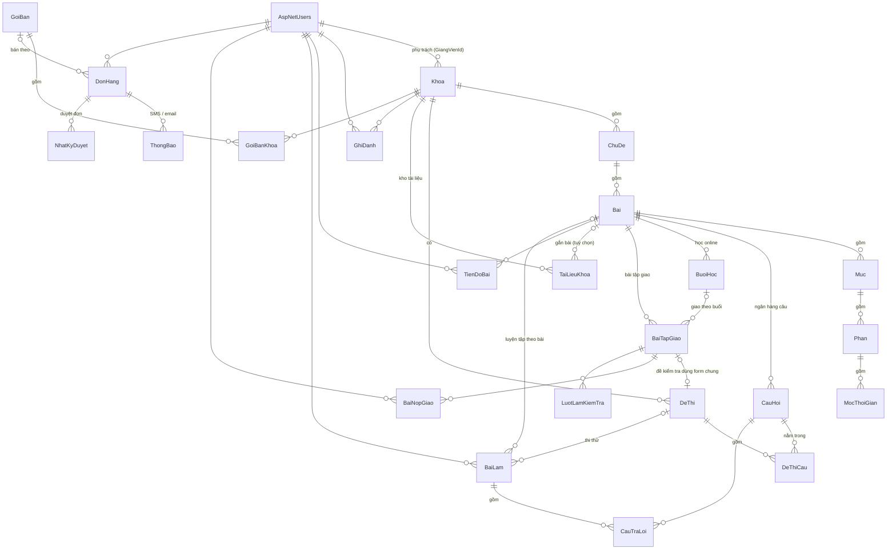

# Thiết kế cơ sở dữ liệu SửĐịa.AI

PostgreSQL 14+, truy cập qua Entity Framework Core (Npgsql). Mô hình nằm trong `Data/ThucThe.cs`, `Data/BaiTapGiao.cs`, `Data/ThanhToan.cs`. Mọi khoá ngoại, quy tắc xoá và ràng buộc khai báo trong `Data/AppDbContext.cs`. Lịch sử thay đổi nằm ở `Data/Migrations/`; bản thiết kế hiện tại là migration `ThietKeLaiCsdl`.

## 1. Sơ đồ quan hệ



## 2. Các nhóm bảng

| Nhóm | Bảng | Ghi chú |
|---|---|---|
| Tài khoản | `AspNetUsers` (NguoiDung), `AspNetRoles`… | ASP.NET Identity; vai trò HocVien / GiangVien / Admin |
| Nội dung | `Khoa` → `ChuDe` → `Bai` → `Muc` → `Phan` → `MocThoiGian` | Cây nội dung bài giảng. Trợ lý AI đọc từ đây (chỉ khoá đang hiện, bài đã xuất bản) |
| Câu hỏi & đề | `CauHoi`, `DeThi`, `DeThiCau` | `DeThiCau` là bảng nối có thứ tự câu |
| Kho tài liệu | `TaiLieuKhoa` | Tệp gốc giảng viên tải lên (Word, PowerPoint, PDF, .txt, .md) nằm trên đĩa ở `App_Data/kho-tai-lieu/<khoá>/`, ngoài wwwroot. Chữ trích ra lưu trong cột `NoiDung` để học viên tìm và trợ lý AI đọc. Xem mục 10 |
| Giảng dạy | `BuoiHoc`, `BaiTapGiao`, `LuotLamKiemTra` | Nội dung bài tập lưu `jsonb` (`NoiDungJson`) |
| Học viên | `GhiDanh`, `TienDoBai`, `BaiLam`, `CauTraLoi`, `BaiNopGiao` | Dữ liệu học tập của học viên, không bao giờ bị xoá dây chuyền |
| Bán hàng | `GoiBan`, `GoiBanKhoa`, `DonHang`, `ThongBao`, `NhatKyDuyet` | Đơn hàng chép lại tên gói, giá, số tháng, danh sách khoá lúc mua |

## 3. Khoá chính và mã

- **Mã khoá** là chuỗi đọc được (`lich-su-12`). Nó nằm trong đường dẫn và khoá ngoại.
- **Mã bài và mã đề** lấy từ **một dãy số chung** `MaBaiDe` nên không bao giờ trùng nhau.
  - Đường dẫn `/Home/LamCauHoi/{mã}` dùng chung cho bài và đề. Web tra bảng `DeThi` để biết mã đó là đề hay bài.
  - Dữ liệu mẫu giữ mã cũ: bài Lịch sử là 1–…, bài Địa lí là 101–…, đề là 1001+ và 2001+. Nhờ vậy đường dẫn cũ vẫn chạy.
  - Sau khi chèn dữ liệu mẫu có mã cố định phải gọi `AppDbContext.DongBoMaTuTangAsync()`.
- Các bảng còn lại dùng mã tự tăng `identity`.
- Bảng nối dùng khoá kép: `GhiDanh (NguoiDungId, KhoaId)`, `TienDoBai (NguoiDungId, BaiId)`, `DeThiCau (DeThiId, ThuTu)`, `GoiBanKhoa (GoiBanId, KhoaId)`, `LuotLamKiemTra (BaiTapGiaoId, NguoiDungId)`.

## 4. Quy tắc xoá

Nguyên tắc: **dữ liệu của học viên luôn được giữ**. Nội dung đã có người dùng thì web chặn xoá và gợi ý ẩn khoá hoặc bỏ xuất bản bài.

| Khi xoá | Hành vi | Lý do |
|---|---|---|
| Khoá còn ghi danh hoặc nằm trong gói | **Chặn** (RESTRICT) | Học viên đã trả tiền |
| Chủ đề, bài | Xoá dây chuyền mục, phần, mốc, buổi học. **Chặn** nếu có tiến độ, bài làm, bài nộp, câu hỏi đã dùng | Giữ lịch sử học |
| Câu hỏi đang nằm trong đề hoặc học viên đã làm | **Chặn** | Trước đây xoá câu thì đề tự hụt câu |
| Bài tập đã có bài nộp | **Chặn** | Trước đây xoá bài tập là mất bài nộp |
| Đề đã có bài làm | **Chặn** | Giữ kết quả thi thử |
| Tài liệu trong kho | Xoá dòng CSDL và tệp trên đĩa. Xoá bài thì tài liệu còn, chỉ bỏ gắn bài (SET NULL). Khoá còn tài liệu thì **chặn** xoá khoá | |
| Buổi học | Bài tập của buổi được giữ, chỉ bỏ gắn buổi (SET NULL) | |
| Gói bán | Đơn cũ giữ nguyên (SET NULL), bảng nối `GoiBanKhoa` xoá theo | Đơn đã chép tên gói và giá |
| Tài khoản có đơn hàng | **Chặn** | Chứng từ thanh toán |
| Tài khoản không có đơn | Xoá theo ghi danh, tiến độ, bài làm, bài nộp của chính người đó | |

Các thao tác xoá quan trọng tự kiểm tra trước và báo lý do (`CauHoiController.Xoa`, `GiaoBaiController.Xoa`, `DeThiController.Xoa`, `NoiDungController.XoaChuDe`). Nếu một thao tác vẫn chạm ràng buộc, `Infrastructure/LoiRangBuocCsdlFilter` đổi lỗi CSDL thành thông báo dễ hiểu và quay lại trang trước, không hiện trang lỗi 500.

## 5. Ràng buộc kiểm tra và duy nhất

| Ràng buộc | Nội dung |
|---|---|
| `CK_DonHang_TrangThai` | `ChoThanhToan`, `DaThanhToan`, `DaHuy` |
| `CK_DonHang_Tien` | `SoTien ≥ 0`, `SoThang > 0` |
| `CK_GoiBan_GiaThang` | Giá trống (chưa bán) hoặc ≥ 0, `SoThang > 0` |
| `CK_ThongBao_Kenh`, `CK_ThongBao_TrangThai` | Kênh `Sms`/`Email`; trạng thái hàng đợi hợp lệ; `SoLanThu ≥ 0` |
| `CK_NhatKyDuyet_QuyetDinh` | `TuDongDuyet`, `CanXemXet`, `TuChoi` |
| `CK_TienDoBai_TrangThai` | 1 = đang học, 2 = đã học |
| `CK_BaiLam_MotNguon` | Bài làm trỏ tới đúng một nguồn: `BaiId` (luyện tập) hoặc `DeThiId` (thi thử), khớp với `LaDeThi` |
| `CK_BaiLam_SoCau` | `0 ≤ SoDung ≤ SoCau` |
| `CK_BaiNopGiao_Diem` | Điểm tự động, điểm tự luận ≥ 0 |
| `CK_DeThi_SoPhut` | ≥ 0 |
| `CK_TaiLieuKhoa_Loai`, `CK_TaiLieuKhoa_TrangThai`, `CK_TaiLieuKhoa_KichThuoc` | Loại tệp hợp lệ, trạng thái `SanSang`/`Loi`, kích thước > 0 |
| `IX_TaiLieuKhoa_KhoaId_MaBam` | Một tệp (cùng mã băm SHA-256) chỉ lưu một lần trong mỗi khoá |
| `UQ_Bai_ChuDe_So` | Không trùng số bài trong một chủ đề |
| `UQ_Muc_Bai_So` | Không trùng số mục trong một bài |
| `IX_BaiNopGiao_BaiTapGiaoId_NguoiDungId` | Mỗi học viên nộp một lần cho mỗi bài tập |
| `IX_DonHang_MaThanhToan` | Mã thanh toán PayOS duy nhất |
| `IX_ThongBao_DonHangId_Kenh_Loai` | Mỗi đơn chỉ gửi một thông báo mỗi kênh, mỗi loại |

`UQ_Bai_ChuDe_So` và `UQ_Muc_Bai_So` là ràng buộc **DEFERRABLE INITIALLY DEFERRED**. CSDL chỉ kiểm tra lúc chốt giao dịch, nên đánh số lại cả loạt mục trong một lần lưu không bị chặn giữa chừng, ví dụ khi xoá mục hoặc thay nội dung bài.

`BaiTapGiao.NoiDungJson`, `BaiNopGiao.TraLoiJson` và `NhatKyDuyet.DuLieuJson` có kiểu `jsonb`, nên CSDL từ chối JSON hỏng ngay lúc lưu.

## 6. Dữ liệu chép lại (cố ý không chuẩn hoá)

| Cột | Lý do |
|---|---|
| `DonHang.TenGoi`, `SoTien`, `SoThang`, `KhoaIds` | Sửa hoặc xoá gói sau này không làm đổi đơn đã bán |
| `BaiLam.TenDe`, `SoCau`, `SoDung` | Đổi tên hoặc sửa đề không làm sai lịch sử điểm |
| `Bai.SoMuc` | Đếm sẵn cho danh sách bài |

## 7. Cột hệ thống

- `CapNhatLuc` có ở `Khoa`, `ChuDe`, `Bai`, `Muc`, `CauHoi`, `DeThi`, `BaiTapGiao`, `GoiBan`, `TaiLieuKhoa`. `AppDbContext.SaveChanges` tự ghi cột này mỗi lần thêm hoặc sửa, qua interface `ICoCapNhat`.
- Giờ lưu theo UTC (`timestamp with time zone`). Giao diện đổi sang giờ máy khi hiển thị.
- `TaiLieuThayDoiInterceptor` báo trợ lý AI nạp lại tài liệu sau mỗi lần lưu khoá, bài, mục, phần, mốc, gói hoặc tài liệu trong kho.

## 8. Ổn định kết nối

- `EnableRetryOnFailure(3)` tự thử lại khi kết nối CSDL lỗi tạm thời.
- Giao dịch tự mở trong code phải chạy trong `Database.CreateExecutionStrategy()`. Ví dụ là `DonHangService.XacNhanDaThanhToanAsync`, đoạn chuyển đơn sang đã thanh toán và cộng hạn học.
- Log câu lệnh SQL của EF chỉ hiện từ mức Warning (`appsettings.json`).

## 9. Vận hành

- **Sao lưu trước mỗi lần cập nhật cấu trúc**

  ```bash
  pg_dump -h localhost -U <user> -d sudia_dev -Fc -f sudia_$(date +%Y%m%d_%H%M).dump
  ```

- **Khôi phục**

  ```bash
  createdb sudia_khoi_phuc
  pg_restore -d sudia_khoi_phuc --no-owner <file>.dump
  ```

- **Cập nhật cấu trúc:** web tự chạy migration khi khởi động. Muốn chạy tay thì dùng `dotnet ef database update`.
- **Lùi một bản:** `dotnet ef database update <migration trước>`. Migration `ThietKeLaiCsdl` có chiều lùi đầy đủ: trả mảng `KhoaIds` cho gói và cột `MaDe` cho bài làm.
- **Kiểm thử cấu trúc:**

  ```bash
  SUDIA_TEST_URL=http://localhost:5280 python3 KiemThu/kiem-tra-csdl.py
  ```

## 10. Kho tài liệu và nguồn của trợ lý AI

Dữ liệu tách thành ba nơi để mở rộng được khi dự án lớn:

| Phần | Nơi lưu | Ghi chú |
|---|---|---|
| Tệp gốc (Word, PowerPoint, PDF…) | **Kho chuẩn S3: Cloudflare R2** (`KhoTaiLieu:NoiLuu = S3`), hoặc đĩa máy chủ khi chạy thử (`CucBo`) | Mỗi dòng `TaiLieuKhoa` ghi `NoiLuu` riêng, nên có thể chuyển dần từ đĩa lên R2 |
| Thông tin tài liệu và chữ trích | PostgreSQL, bảng `TaiLieuKhoa` | |
| Chỉ mục tìm kiếm | PostgreSQL, bảng `DoanChiMuc`: cột `tsvector` chữ đã bỏ dấu (hàm `f_bo_dau` dùng `unaccent`) + chỉ mục GIN | Mọi máy chủ web dùng chung, không chiếm RAM |

```
Giảng viên tải tệp (Giảng viên › Kho tài liệu, hoặc nhập Word/PowerPoint lúc soạn bài)
   → kiểm tra đuôi tệp, chữ ký tệp, ≤ 20 MB → băm SHA-256 (trùng thì bỏ qua)
   → trích chữ: Word/PowerPoint (DocTaiLieuOffice), PDF (PdfPig, mỗi trang một tiêu đề "Trang n"), .txt/.md
   → cất tệp gốc lên R2 (hoặc đĩa) với khoá đối tượng khoa/<mã khoá>/<guid>.<đuôi>
   → lưu dòng TaiLieuKhoa
Mỗi lần lưu khoá / chủ đề / bài / mục / phần / mốc / tài liệu / gói:
   TaiLieuThayDoiInterceptor → DongBoChiMuc (tiến trình nền, gom việc trong ~0,5 giây)
   → chỉ dựng lại đúng đơn vị bị ảnh hưởng ("Bai:7", "TaiLieu:12", "Khoa:lich-su-12", "Goi") trong bảng DoanChiMuc
   → khởi động khi chỉ mục trống, và mỗi 12 giờ: dựng lại toàn bộ để bắt thay đổi không qua EF
Tìm kiếm (KhoTaiLieu.TimKiemAsync): âm tiết của câu hỏi ghép OR + cộng điểm cặp âm tiết liền nhau, xếp bằng ts_rank_cd
   ├─ Học viên › Tài liệu: tìm trong bài học và tài liệu của các khoá đang học, mở / tải tệp gốc
   └─ Trợ lý AI: lấy 6 đoạn liên quan nhất từ đúng chỉ mục này để trả lời, kèm nguồn
```

- **Quyền:**
  - Học viên chỉ tìm và mở được tài liệu của khoá mình còn hạn học.
  - Giảng viên chỉ quản lý được kho của khoá mình được gán. Admin quản lý mọi khoá.
  - Tệp trên R2 không công khai. Web kiểm quyền rồi mới chuyển người dùng sang link ký tạm 5 phút. Tệp trên đĩa thì web gửi thẳng.
- **Tắt "Học viên thấy":** tài liệu thành nội bộ. Học viên không tìm thấy, trợ lý AI không đọc.
- **Tệp không đọc được chữ** (PDF scan ảnh, tệp có mật khẩu): vẫn lưu và tải về được, nhưng không tìm thấy nội dung. Giảng viên thấy cột "Chưa đọc được chữ".
- **Sao lưu:** `pg_dump` cho CSDL. Tệp trên R2 do Cloudflare lưu trữ; nếu cần thêm bản sao thì bật sao chép bucket. Nếu còn tệp trên đĩa thì chép cả thư mục `App_Data/kho-tai-lieu/`, thư mục này nằm trong `.gitignore`.
- **Kiểm thử:**

  ```bash
  SUDIA_TEST_URL=http://localhost:5280 python3 KiemThu/kiem-tra-kho-tai-lieu.py
  ```

  Chạy được với cả web dùng đĩa lẫn web dùng S3.

### Cấu hình Cloudflare R2

1. **Tạo bucket:** vào dash.cloudflare.com → R2 → **Create bucket**, đặt tên ví dụ `sudia-tai-lieu`. Giữ chế độ riêng tư, không bật public access.
2. **Tạo khoá:** R2 → **Manage R2 API Tokens** → **Create API token**, quyền **Object Read & Write**, chỉ cho bucket trên. Ghi lại *Access Key ID*, *Secret Access Key* và địa chỉ *S3 API*, dạng `https://<account-id>.r2.cloudflarestorage.com`.
3. **Đặt cấu hình:** khoá bí mật không ghi vào `appsettings.json`.

   ```bash
   dotnet user-secrets set "KhoTaiLieu:NoiLuu" "S3"
   dotnet user-secrets set "KhoTaiLieu:S3:DiaChi" "https://<account-id>.r2.cloudflarestorage.com"
   dotnet user-secrets set "KhoTaiLieu:S3:Bucket" "sudia-tai-lieu"
   dotnet user-secrets set "KhoTaiLieu:S3:AccessKey" "<Access Key ID>"
   dotnet user-secrets set "KhoTaiLieu:S3:SecretKey" "<Secret Access Key>"
   ```

   Trên máy chủ thật, đặt bằng biến môi trường: `KhoTaiLieu__NoiLuu`, `KhoTaiLieu__S3__DiaChi`… Vùng (`KhoTaiLieu:S3:Vung`) giữ `auto`.
4. **Chuyển tệp cũ:** chạy `dotnet run -- --chuyen-kho-tep` để đưa các tệp đang nằm trên đĩa lên R2. Lệnh kiểm mã băm từng tệp và chỉ xoá bản trên đĩa sau khi đã lên R2. Chạy lại nhiều lần vẫn an toàn.

Dùng AWS S3 thay R2 thì để trống `DiaChi` và đặt `Vung` (ví dụ `ap-southeast-1`). MinIO tự dựng thì `DiaChi` là địa chỉ máy MinIO.

## 11. Lớp học và diễn đàn hỏi đáp

| Bảng | Vai trò | Khoá ngoại / quy tắc xoá |
| --- | --- | --- |
| `Lop` | Lớp của một khoá; có `MaThamGia` 6 ký tự (duy nhất), `DangMo` | `KhoaId` → Khoa (RESTRICT) |
| `LopHocVien` | Thành viên lớp, khoá chính (`LopId`, `NguoiDungId`) | Lop, NguoiDung: CASCADE |
| `BaiDang` | Chủ đề thảo luận, có `Ghim`, `DaDong` | Lop: CASCADE; NguoiDung: RESTRICT |
| `TraLoiBaiDang` | Trả lời, có `LaDapAn` | BaiDang: CASCADE; NguoiDung: RESTRICT |

Ràng buộc kiểm tra: tên lớp 1–100 ký tự, tiêu đề 1–200, nội dung 1–4000 (`CK_Lop_Ten`, `CK_BaiDang_*`, `CK_TraLoiBaiDang_NoiDung`).

Quy tắc: giảng viên của khoá (hoặc admin) tạo lớp và quản lý; học viên vào lớp bằng mã nếu đang học khoá của lớp (ghi danh còn hạn); chỉ thành viên và người quản lý mới xem diễn đàn. Mỗi người tối đa 10 bài và 30 trả lời mỗi giờ. Xoá lớp xoá luôn thành viên, bài đăng, trả lời. Kiểm thử: `KiemThu/kiem-tra-lop-hoc.py` (10 nhóm kiểm tra).
