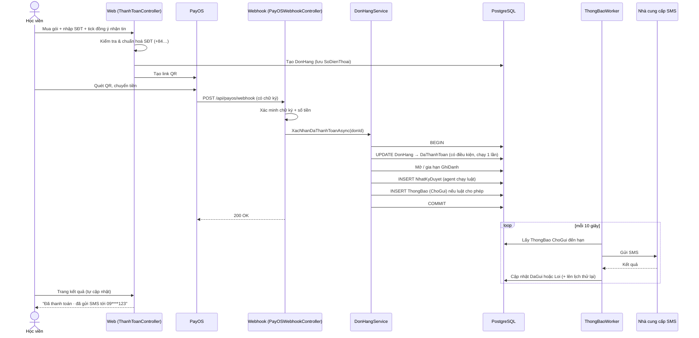

# Kế hoạch thực thi: thanh toán QR → gửi SMS → duyệt tự động

**Người thực hiện:** Codex  **Người duyệt:** anh Quyến  **Trạng thái:** chỉ là bản thiết kế, chưa có dòng mã nào.
**Phạm vi đợt này:** SMS. Facebook Messenger làm sau (xem mục 12).

Tài liệu này chỉ nêu **cách làm**. Mọi đường dẫn, tên bảng và hàm bên dưới đã đối chiếu với mã hiện tại (nhánh `dev`).

---

## 1. Mục tiêu

Khi học viên chuyển tiền thành công qua mã QR PayOS:

1. Hệ thống **tự mở khoá học** (đã có sẵn).
2. Hệ thống **gửi SMS** báo đã nhận tiền tới số điện thoại học viên nhập lúc mua.
3. Một **"AI agent quản lý" ghi nhật ký và duyệt đơn tự động**, đánh dấu đơn bất thường để người xem xét.

## 2. Nguyên tắc bất biến (không được vi phạm)

| # | Nguyên tắc | Lý do |
| --- | --- | --- |
| 1 | **Chỉ tiền về mới được duyệt.** Bằng chứng duy nhất là webhook PayOS đã xác minh chữ ký, hoặc kết quả hỏi lại PayOS (`LayTrangThaiAsync`) có `PAID` và `AmountPaid >= SoTien`. | Số điện thoại, link Facebook hay lời khách nói không chứng minh được đã trả tiền. |
| 2 | **AI không được tự quyết định tiền.** Agent giai đoạn này là **luật cố định** (rule-based). Mô hình ngôn ngữ nếu dùng chỉ để *giải thích* đơn bất thường, không được mở khoá hay từ chối. | Tránh bị lừa bằng nội dung do khách nhập. |
| 3 | **SMS không được chặn luồng mở khoá.** Gửi SMS lỗi thì đơn vẫn `DaThanhToan`, khoá vẫn mở, SMS thử lại sau. | Khách đã trả tiền thì phải học được. |
| 4 | **Mỗi đơn tối đa một SMS "đã thanh toán".** Webhook gọi lặp, trang kết quả gọi cùng lúc cũng không gửi trùng. | `XacNhanDaThanhToanAsync` đã chặn bằng `UPDATE` có điều kiện; tận dụng đúng điểm đó. |
| 5 | **Chống lợi dụng gửi SMS rác.** Chỉ gửi **sau khi tiền về**, tối đa 1 tin/đơn, giới hạn theo số điện thoại và theo ngày. | Nếu gửi ngay lúc khách bấm mua, kẻ xấu nhập số người khác để làm phiền. |
| 6 | **Không ghi khoá API vào Git.** Dùng user-secrets / biến môi trường như PayOS. | Quy tắc chung của dự án. |
| 7 | **Không ghi số điện thoại đầy đủ vào log.** Log dạng `09****123`. | Dữ liệu cá nhân. |

## 3. Luồng thực thi từ đầu đến cuối



**Điểm móc duy nhất** để thêm logic: bên trong `DonHangService.XacNhanDaThanhToanAsync` (`Services/DonHangService.cs`), ngay sau khi `doi > 0` (tức lần gọi này là lần đầu xác nhận đơn) và **trước** `tx.CommitAsync`. Làm vậy thì ghi `ThongBao` và `NhatKyDuyet` nằm cùng giao dịch với việc mở khoá: hoặc cùng thành công, hoặc cùng huỷ.

## 4. Thay đổi cơ sở dữ liệu

Tạo migration mới tên `ThongBaoSmsThanhToan` bằng `dotnet ef migrations add` (đã có 15 migration trong `Data/Migrations/`; ứng dụng tự chạy migration khi khởi động).

### 4.1. Thêm cột vào `DonHang` (`Data/ThanhToan.cs`)

| Cột | Kiểu | Ghi chú |
| --- | --- | --- |
| `SoDienThoai` | `string?` (tối đa 16) | Dạng chuẩn `+84901234567`. Null nếu khách không nhập. |
| `DongYNhanTin` | `bool` | Mặc định `false`. Chỉ gửi SMS khi `true`. |
| `LinkFacebook` | `string?` (tối đa 200) | Chỉ lưu, **chưa dùng để gửi** ở đợt này. |

### 4.2. Bảng mới `ThongBao` (hàng đợi gửi tin, dạng outbox)

| Cột | Kiểu | Ghi chú |
| --- | --- | --- |
| `Id` | int, khoá chính | |
| `DonHangId` | int, FK → `DonHang` | |
| `NguoiDungId` | string | |
| `Kenh` | string | `Sms` (sau này `Messenger`). |
| `Loai` | string | `DaThanhToan` (sau này thêm `SapHetHan`…). |
| `NguoiNhan` | string | Số điện thoại chuẩn hoá. |
| `NoiDung` | string | Nội dung đã dựng sẵn. |
| `TrangThai` | string | `ChoGui` → `DaGui` / `Loi` / `BoQua`. |
| `SoLanThu` | int | Tối đa 5. |
| `GuiLuc` | timestamptz null | |
| `GuiTiepLuc` | timestamptz | Thời điểm được phép gửi/thử lại. |
| `MaNhaCungCap` | string null | Mã tin do nhà cung cấp trả. |
| `LoiCuoi` | string null | Cắt tối đa 500 ký tự. |
| `TaoLuc` | timestamptz | |

Chỉ mục: **duy nhất** trên `(DonHangId, Kenh, Loai)` — đây là chốt chặn gửi trùng; thêm chỉ mục `(TrangThai, GuiTiepLuc)` cho worker.

### 4.3. Bảng mới `NhatKyDuyet` (nhật ký của agent)

| Cột | Kiểu | Ghi chú |
| --- | --- | --- |
| `Id` | int | |
| `DonHangId` | int, FK | |
| `ThoiDiem` | timestamptz | |
| `TacNhan` | string | `PayOS-Webhook`, `PayOS-KetQua`, `Agent-Luat`, `Admin`. |
| `QuyetDinh` | string | `TuDongDuyet`, `CanXemXet`, `TuChoi`. |
| `LyDo` | string | Câu ngắn, người đọc hiểu được. |
| `DuLieuJson` | jsonb | Các số liệu dùng để quyết định (số tiền nhận, số đơn cùng SĐT…). **Không** chứa chữ ký hay khoá. |

## 5. Các thành phần mã cần tạo

Thứ tự tạo cũng là thứ tự nên làm (mục 10).

```text
Services/
├── Sms/
│   ├── ISmsSender.cs            # interface + record KetQuaGuiSms(bool ThanhCong, string? MaTin, string? Loi, bool CoTheThuLai)
│   ├── SmsOptions.cs            # mục cấu hình "Sms"
│   ├── LogSmsSender.cs          # Development: chỉ ghi log, không gửi thật
│   └── <NhaCungCap>SmsSender.cs # gửi thật, dùng HttpClient như PayOSService
├── SoDienThoai.cs               # chuẩn hoá + kiểm tra số VN (hàm tĩnh, dễ test)
├── ThongBaoService.cs           # dựng nội dung, ghi hàng đợi, che số
├── ThongBaoWorker.cs            # BackgroundService quét hàng đợi
└── DuyetDonAgent.cs             # luật duyệt, trả về quyết định + lý do
```

### 5.1. `ISmsSender`

```csharp
public interface ISmsSender
{
    Task<KetQuaGuiSms> GuiAsync(string soDienThoai, string noiDung, CancellationToken ct);
}
```

- Đăng ký trong `Program.cs`: Development chưa có khoá → `LogSmsSender`; có khoá → bản gửi thật (`AddHttpClient`, timeout 15 giây, giống cách `PayOSService` đang làm).
- Bản gửi thật phải phân biệt **lỗi tạm thời** (mạng, 5xx, hết hạn mức tạm) → `CoTheThuLai = true`, và **lỗi vĩnh viễn** (số sai, nội dung bị từ chối) → `CoTheThuLai = false`.
- Không ném ngoại lệ ra ngoài; luôn trả `KetQuaGuiSms`.

### 5.2. `SoDienThoai` (chuẩn hoá và kiểm tra)

- Chấp nhận `0901234567`, `+84901234567`, `84901234567`, bỏ khoảng trắng, dấu chấm, dấu gạch.
- Regex sau khi chuẩn hoá về dạng `0…`: `^0(3|5|7|8|9)\d{8}$`. Lưu dạng `+84…`.
- Hàm `Che(string)` trả `+84****4567` để hiển thị và ghi log.

### 5.3. `ThongBaoService`

- `DungNoiDungDaThanhToan(DonHang don, DateTime? hanMoiNhat)` trả chuỗi SMS (xem mục 6).
- `GhiHangDoiAsync(...)`: thêm `ThongBao`. Nếu vi phạm chỉ mục duy nhất → **bỏ qua im lặng** (đã có tin rồi), không được làm hỏng giao dịch mở khoá.
- Kiểm tra giới hạn trước khi ghi: tối đa **3 SMS/ngày/số điện thoại** và **10 SMS/ngày/tài khoản** (cấu hình được). Vượt giới hạn → ghi `TrangThai = BoQua`, `LoiCuoi = "Vượt giới hạn ngày"`.

### 5.4. `ThongBaoWorker : BackgroundService`

- Đăng ký bằng `AddHostedService`.
- Vòng lặp mỗi **10 giây**: lấy tối đa 20 dòng `ChoGui` có `GuiTiepLuc <= now`.
- **Khoá dòng khi xử lý** để chạy nhiều bản sao (ví dụ hai tiến trình) không gửi trùng: dùng `FOR UPDATE SKIP LOCKED` hoặc `UPDATE … SET TrangThai='DangGui' … WHERE Id=… AND TrangThai='ChoGui'` rồi kiểm tra số dòng ảnh hưởng.
- Gửi xong:
  - Thành công → `DaGui`, ghi `GuiLuc`, `MaNhaCungCap`.
  - Lỗi tạm thời → `SoLanThu++`, `GuiTiepLuc = now + {30s, 2m, 10m, 1h, 6h}`; quá 5 lần → `Loi`.
  - Lỗi vĩnh viễn → `Loi` ngay.
- Mỗi lần lặp bọc `try/catch` toàn bộ; worker **không bao giờ được chết** vì một lỗi.

### 5.5. `DuyetDonAgent` (luật cố định)

Chạy bên trong giao dịch của `XacNhanDaThanhToanAsync`, nhận đơn + số tiền thực nhận, trả `(QuyetDinh, LyDo, DuLieu)`.

| Luật | Điều kiện | Quyết định |
| --- | --- | --- |
| R1 | Tiền nhận `>=` `SoTien` và nguồn là webhook đã xác minh (hoặc hỏi lại PayOS) | `TuDongDuyet` |
| R2 | Tiền nhận `<` `SoTien` | **Không mở khoá**, `CanXemXet` (webhook hiện đã chặn ở đây, giữ nguyên hành vi) |
| R3 | Cùng một số điện thoại gắn với **≥ 3 tài khoản khác nhau** trong 24 giờ | `TuDongDuyet` nhưng **gắn cờ** `CanXemXet`, **không gửi SMS** |
| R4 | Cùng tài khoản có **≥ 3 đơn** `DaThanhToan` trong 1 giờ | `TuDongDuyet` + gắn cờ |
| R5 | Không có số điện thoại hoặc `DongYNhanTin = false` | `TuDongDuyet`, **không** ghi `ThongBao` (`BoQua`) |

Mọi quyết định đều ghi `NhatKyDuyet` kèm lý do. Giai đoạn 2 (không làm đợt này): cho phép gọi Claude chỉ để viết đoạn giải thích cho admin khi có cờ `CanXemXet`.

## 6. Nội dung SMS

- **Không dấu**, tối đa **160 ký tự** (một tin). SMS có dấu tiếng Việt chỉ chứa 70 ký tự và dễ bị chia tin tốn tiền.
- Mẫu:

```text
SuDia: Don {MaDonRutGon} da thanh toan {SoTien}d. Goi {TenGoiKhongDau} da mo, han den {dd/MM/yyyy}. Hoc ngay: {Domain}/ThanhToan
```

- Dựng bằng hàm bỏ dấu có sẵn trong `Services/Chuoi.cs` (kiểm tra tên hàm trước khi viết mới).
- Cắt `TenGoi` nếu quá dài để tổng không vượt 160.
- **Phụ thuộc bên ngoài:** nhà mạng Việt Nam thường yêu cầu **đăng ký brandname và mẫu tin**. Chưa đăng ký thì dùng đầu số ngẫu nhiên, dễ bị chặn. Ghi vào mục câu hỏi mở (mục 12).

## 7. Thay đổi giao diện và controller

### 7.1. Trang xác nhận mua (`Views/ThanhToan/Mua.cshtml`, `ThanhToanController.TaoDon`)

- Thêm khối **"Nhận thông báo khi thanh toán xong"** trong cột trái, dưới phần phương thức thanh toán:
  - Ô **Số điện thoại** (`type="tel"`, `autocomplete="tel"`), điền sẵn từ `NguoiDung.PhoneNumber` nếu có.
  - Checkbox **"Gửi tin nhắn SMS xác nhận tới số này"** (tick sẵn nếu có số).
  - Ô **Link Facebook** (tuỳ chọn), kèm chú thích "Dùng cho thông báo qua Messenger ở bản sau".
- Kiểm tra **phía máy chủ** trong `TaoDon`: nếu tick nhận tin mà số sai → báo lỗi bằng `TempData["LoiThanhToan"]` và quay lại trang `Mua`. Link Facebook nếu có phải khớp `^https://(www\.|m\.)?facebook\.com/[\w.\-/?=&%]+$`.
- Truyền số đã chuẩn hoá vào `DonHangService.TaoDonAsync` (thêm tham số), lưu vào `DonHang`.
- Tuỳ chọn: lưu số vào hồ sơ (`NguoiDung.PhoneNumber`) nếu học viên chưa có.
- Cập nhật `MuaGoiViewModel` (`Models/ThanhToanModels.cs`) thêm các trường tương ứng.

### 7.2. Trang kết quả (`Views/ThanhToan/KetQua.cshtml`)

- Thêm dòng trạng thái thông báo, đọc từ `ThongBao` của đơn:
  - `ChoGui` → "Đang gửi SMS tới +84****4567…"
  - `DaGui` → "Đã gửi SMS tới +84****4567 lúc HH:mm"
  - `Loi` → "Chưa gửi được SMS. Khoá học vẫn đã được mở." (kèm gợi ý xem lại trong Đơn hàng)
  - Không có → ẩn dòng.
- Endpoint `TrangThai` hiện trả `{ trangThai }`; **thêm** trường `sms` để trang cập nhật dòng này mà không tải lại.

### 7.3. Trang admin (mục mới "Thông báo & duyệt đơn")

- Thêm controller `Areas/Admin/Controllers/ThongBaoController.cs`, view tương ứng, và mục menu trong nhóm **Kinh doanh** (cạnh Doanh thu & đơn hàng).
- Hai tab: **Thông báo** (lọc theo trạng thái, nút **Gửi lại** cho dòng `Loi`, chỉ gửi lại đúng dòng đó, không tạo tin mới) và **Nhật ký duyệt** (lọc theo `QuyetDinh`, ưu tiên `CanXemXet`).
- Số điện thoại hiển thị đã che; chỉ xem đủ số khi bấm "Hiện" (ghi `NhatKyDuyet` với `TacNhan = Admin`).

## 8. Cấu hình và bí mật

`appsettings.json`, thêm mục:

```json
"Sms": {
  "Bat": false,
  "NhaCungCap": "",
  "Brandname": "",
  "ToiDaMoiNgayMoiSo": 3,
  "ToiDaMoiNgayMoiTaiKhoan": 10,
  "TenMien": ""
}
```

- Khoá (`ApiKey`, `SecretKey`) **không** để trong file; đặt bằng user-secrets / biến môi trường `Sms__ApiKey`, `Sms__SecretKey`.
- Viết `scripts/cau-hinh-sms.zsh` theo mẫu `scripts/cau-hinh-payos.zsh` (nhập ẩn, ghi vào user-secrets).
- `Sms:Bat = false` hoặc thiếu khoá → dùng `LogSmsSender` ở Development; ở môi trường thật thì `ThongBao` ghi `BoQua` với lý do "Chưa cấu hình SMS" và **không** gây lỗi.

## 9. Kiểm thử và tiêu chí nghiệm thu

Tạo `KiemThu/kiem-tra-thanh-toan-sms.py` theo phong cách các script hiện có (HTTP local + `psql`, dọn dữ liệu sau khi chạy, chỉ chạy ở Development).

| # | Kịch bản | Kỳ vọng |
| --- | --- | --- |
| T1 | Webhook hợp lệ, đơn có SĐT + đồng ý | Đơn `DaThanhToan`, khoá mở, **đúng 1** `ThongBao`, 1 dòng `NhatKyDuyet = TuDongDuyet` |
| T2 | Gọi cùng webhook 5 lần liên tiếp | Vẫn **1** `ThongBao`, ghi danh chỉ cộng hạn **một lần** |
| T3 | Webhook sai chữ ký | 400, đơn không đổi, không `ThongBao` |
| T4 | Tiền nhận nhỏ hơn giá | Đơn không mở khoá, không `ThongBao`, có nhật ký `CanXemXet` |
| T5 | Nhà cung cấp SMS trả lỗi tạm thời | Đơn vẫn mở khoá; `ThongBao` thử lại theo lịch; sau 5 lần → `Loi` |
| T6 | Nhà cung cấp trả lỗi vĩnh viễn | `Loi` ngay, không thử lại |
| T7 | SĐT sai định dạng khi mua | Báo lỗi tại trang `Mua`, **không** tạo đơn |
| T8 | Không tick nhận tin | Không `ThongBao` (`BoQua`) |
| T9 | Một SĐT gắn với 3 tài khoản trong 24 giờ | Duyệt nhưng gắn cờ, không gửi SMS |
| T10 | Hai tiến trình worker chạy song song | Mỗi `ThongBao` chỉ gửi 1 lần |
| T11 | Trang kết quả khi `DaGui` / `Loi` | Dòng trạng thái đúng, số bị che |
| T12 | Học viên A mở `KetQua` / `TrangThai` của đơn học viên B | 404 (giữ nguyên hành vi hiện tại) |

Đạt khi: `dotnet build` 0 lỗi 0 cảnh báo, các script `KiemThu/` cũ vẫn PASS, script mới PASS 12/12, và log không còn số điện thoại đầy đủ (kiểm bằng `grep`).

## 10. Thứ tự thực hiện (mỗi dòng một nhánh con, tách từ `dev`)

| Bước | Nhánh | Nội dung | Xong khi |
| --- | --- | --- | --- |
| 1 | `feat/payment-sms-data` | Cột mới ở `DonHang`, bảng `ThongBao`, `NhatKyDuyet`, migration | Khởi động ứng dụng tự migrate được, bảng có chỉ mục duy nhất |
| 2 | `feat/payment-sms-sender` | `ISmsSender`, `SmsOptions`, `LogSmsSender`, `SoDienThoai`, 1 nhà cung cấp thật, script cấu hình | Gửi thử được 1 tin ở Development (log) và 1 tin thật khi có khoá |
| 3 | `feat/payment-sms-queue` | `ThongBaoService`, `ThongBaoWorker`, `DuyetDonAgent`, móc vào `XacNhanDaThanhToanAsync` | T1, T2, T4, T5, T6, T10 PASS |
| 4 | `feat/payment-sms-ui` | Ô nhập SĐT ở trang `Mua`, dòng trạng thái ở `KetQua`, kiểm tra phía máy chủ | T7, T8, T11, T12 PASS |
| 5 | `feat/payment-sms-admin` | Trang admin Thông báo & duyệt đơn, nút gửi lại | Admin xem và gửi lại được, T9 PASS |
| 6 | `docs/payment-sms` | Cập nhật `README.md` (luồng, cấu hình, đường dẫn) và `docs/tai-lieu-du-an.md` | Tài liệu khớp mã |

Quy ước Git của dự án (anh đã yêu cầu):
- Commit theo Conventional Commits tiếng Anh, chia nhỏ theo từng phần việc.
- **Chỉ đứng tên anh**, không thêm dòng `Co-Authored-By` hay nhắc tới AI trong commit.
- Gộp từng nhánh vào `dev` bằng merge commit; **không** gộp vào `main` khi chưa được anh duyệt.
- Không đưa `claude-sessions/`, `output/`, khoá API hay `appsettings.Development.json` lên Git.
- Trước khi push: kiểm tra không lộ khoá, không file lớn, không dữ liệu thử.

## 11. Rủi ro và cách giảm

| Rủi ro | Cách giảm |
| --- | --- |
| Gửi SMS tới số người khác (làm phiền) | Chỉ gửi sau khi tiền về, 1 tin/đơn, giới hạn theo số và theo ngày, luật R3 |
| Khách tưởng SMS là bằng chứng thanh toán | Nội dung SMS chỉ là thông báo; nguồn sự thật là trạng thái đơn trong hệ thống |
| Tin nhắn bị nhà mạng chặn | Đăng ký brandname và mẫu tin; cho phép admin gửi lại |
| Lộ dữ liệu cá nhân | Che số khi hiển thị và ghi log; chỉ lưu số cần thiết; có checkbox đồng ý rõ ràng |
| Worker chết hoặc gửi trùng | `try/catch` toàn vòng lặp, khoá dòng khi xử lý, chỉ mục duy nhất `(DonHangId, Kenh, Loai)` |
| Webhook không tới được máy chủ | Trang kết quả vẫn hỏi lại PayOS định kỳ (đã có); agent chạy ở cả hai đường vào |

## 12. Câu hỏi mở cần anh quyết trước khi làm bước 2

1. **Nhà cung cấp SMS** nào (eSMS, SpeedSMS, Twilio hay khác) và ai đăng ký brandname/mẫu tin?
2. **Tên miền HTTPS công khai** để khai báo webhook PayOS và đặt vào nội dung SMS?
3. Chấp nhận quy tắc **chỉ tự duyệt khi PayOS xác nhận tiền về** (mục 2, nguyên tắc 1–2)?
4. **Messenger:** cần Facebook Page, ứng dụng Meta và quyền gửi tin; khách thường phải nhắn Page trước (cửa sổ 24 giờ). Link Facebook cá nhân **không đủ** để gửi tin, cần PSID. Làm ở đợt sau.
5. **Giới hạn ngày** (3 tin/số, 10 tin/tài khoản) đã hợp lý chưa?
6. Cần lưu số điện thoại bao lâu? (Nghị định 13/2023/NĐ-CP về bảo vệ dữ liệu cá nhân: nên có thời hạn lưu và cách xoá khi người dùng yêu cầu.)

## 13. Lời nhắc giao cho Codex

> Đọc `docs/ke-hoach-thanh-toan-sms.md`. Làm **lần lượt từng bước ở mục 10**, mỗi bước một nhánh từ `dev`. Dừng lại và báo anh sau mỗi bước, kèm kết quả build và các kịch bản kiểm thử đã chạy. Không làm bước 2 trở đi khi anh chưa trả lời câu hỏi 1 và 3 ở mục 12. Không tự gộp vào `main`. Nếu mã thực tế khác tài liệu này (tên hàm, đường dẫn), ghi rõ chỗ khác và hỏi anh trước khi đổi hướng.

---

## 14. Phụ lục vòng 2 (sau lần Codex làm bước 1–5)

Mã bước 1–5 đã có trong thư mục làm việc nhưng chưa vào Git. Vòng này sửa lỗi, thêm email và đối soát. **Codex chỉ sửa mã, không chạy lệnh `git` nào** (môi trường chặn ghi `.git`); người giao việc sẽ tự commit.

### 14.1. Sửa lỗi bắt buộc

| # | Lỗi | Cách sửa |
| --- | --- | --- |
| L1 | `LogSmsSender` luôn được đăng ký nên môi trường thật chưa cấu hình SMS vẫn ghi "Đã gửi" | Chọn đầu gửi theo cấu hình: ở **Development** dùng `LogSmsSender` và ghi `MaNhaCungCap = "development-log"`; ở môi trường khác khi `Sms:Bat = false` hoặc chưa có nhà cung cấp thì `ThongBaoService` ghi `BoQua` với `LoiCuoi = "Chưa cấu hình SMS"` và **không** gửi. Giao diện hiển thị dòng `development-log` là "đã gửi (giả lập)". |
| L2 | `NhatKyDuyet.QuyetDinh` luôn là `TuDongDuyet` kể cả khi gắn cờ R3/R4 | `DuyetDonAgent` trả quyết định cụ thể; đơn bị cờ ghi `CanXemXet` (vẫn mở khoá, không gửi SMS). |
| L3 | Worker làm kẹt dòng `DangGui` nếu tiến trình tắt giữa chừng | Thêm cột `DangGuiLuc`; mỗi vòng lặp đưa các dòng `DangGui` quá 5 phút về `ChoGui` (tăng `SoLanThu`). Thêm vào migration mới. |
| L4 | `HanDen` lớn nhất bỏ qua ghi danh không giới hạn (null) | Nếu bất kỳ khoá nào không giới hạn thì nội dung tin ghi "khong gioi han". |

### 14.2. Kênh email (kênh chính)

- Thêm `IEmailSender` + `LogEmailSender` (Development) + `EmailOptions` (mục `Email`: `Bat`, `Tu`, `TenHienThi`, `Host`, `Port`, `TenDangNhap`; **mật khẩu để user-secrets**, không để trong file). Chưa viết bản SMTP thật vì chưa chọn nhà cung cấp: chỉ chừa chỗ cắm.
- Tận dụng bảng `ThongBao`: `Kenh = Email`, `NguoiNhan = NguoiDung.Email`, chỉ mục duy nhất `(DonHangId, Kenh, Loai)` đã chặn gửi trùng. Mở rộng `ThongBaoWorker` để chọn đầu gửi theo `Kenh`.
- Email xác nhận **luôn** được ghi hàng đợi khi đơn được duyệt (không cần ô đồng ý riêng vì là thông báo giao dịch); SMS vẫn cần `DongYNhanTin`. Nội dung có dấu tiếng Việt, gồm: mã đơn, tên gói, số tiền, các khoá đã mở và hạn mới, link trang đơn hàng, link biên lai. Không chèn dữ liệu do khách nhập mà chưa mã hoá HTML.
- Trang kết quả và trang admin hiển thị trạng thái cả hai kênh.

### 14.3. Đối soát đơn kẹt

- Thêm `DoiSoatDonWorker : BackgroundService`, chạy mỗi **2 phút**: lấy các đơn `ChoThanhToan`, tạo trong **15 phút đến 24 giờ** gần đây, tối đa 20 đơn/lượt; hỏi `PayOSService.LayTrangThaiAsync`.
  - `PAID` và `AmountPaid >= SoTien` → `XacNhanDaThanhToanAsync(..., tacNhan: "Doi-Soat")`.
  - `CANCELLED` / `EXPIRED` → `HuyAsync`.
  - Lỗi mạng → bỏ qua, thử lại lượt sau, không ném ngoại lệ ra khỏi vòng lặp.
- Chỉ chạy khi `payos.DaCauHinh`. Ghi `NhatKyDuyet` với `TacNhan = "Doi-Soat"` khi tự xác nhận một đơn mà webhook không tới.
- Đơn quá 24 giờ vẫn `ChoThanhToan` → `HuyAsync`, ghi nhật ký lý do "Quá hạn đối soát".

### 14.4. Kiểm thử

Viết lại `KiemThu/kiem-tra-thanh-toan-sms.py` thành bộ kiểm thử **chạy được** trên máy có PostgreSQL Development: dùng tài khoản tạm, đặt hàng bằng chế độ giả lập thanh toán, kiểm tra bằng `psql` và dọn dữ liệu sau khi chạy. Bao quát được qua đường giả lập: T2, T7, T8, T11, T12, L1, L2, L4 và email. Các ca cần webhook PayOS ký thật (T1, T3, T4) viết thành **hàm riêng, tự bỏ qua kèm lý do rõ ràng** khi thiếu `SUDIA_TEST_PAYOS_CHECKSUM_KEY`; có thể tự ký webhook bằng khoá đó (xem `PayOSService.XacMinhWebhook` để dùng đúng thuật toán). Nếu sandbox không cho kết nối PostgreSQL, ghi rõ không chạy được; **không khẳng định PASS khi chưa chạy**.

### 14.5. Chưa làm ở vòng này

OTP xác minh số điện thoại, Zalo ZNS, Messenger, bản gửi SMS/email thật: chờ anh chọn nhà cung cấp.
